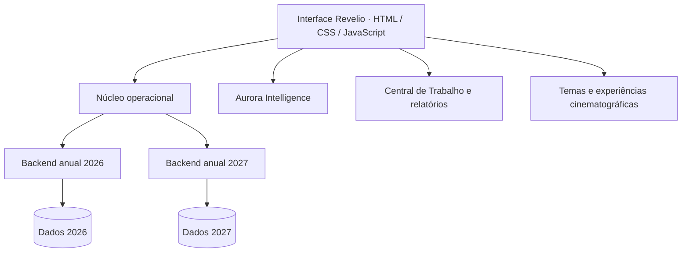

<div align="center">

# ✦ ERP Letícia Lustosa

### REVELIO · v2.3

**Inteligência operacional. Clareza para decidir. Uma experiência com identidade própria.**

Uma aplicação web desenvolvida para transformar a rotina de **encerramentos jurídicos** em um fluxo de trabalho mais organizado, visual e inteligente.

[](#evolução-do-projeto)
[](#a-era-revelio)
[](#cinematic-rebirth--11-identidades-visuais)
[](#sobre-o-projeto)

**[Visão geral](#sobre-o-projeto) · [Funcionalidades](#funcionalidades) · [Aurora](#aurora-intelligence) · [Experiência visual](#cinematic-rebirth--11-identidades-visuais) · [Arquitetura](#arquitetura) · [Execução](#como-executar) · [Evolução](#evolução-do-projeto)**

</div>

---

> **A essência do projeto**
>
> A ERP Letícia Lustosa nasceu de uma necessidade real: reunir registros de processos, produtividade, metas, bonificações, pendências e análises em um único ambiente. A tecnologia existe para simplificar o trabalho — a experiência visual foi construída para tornar essa rotina mais fluida, clara e pessoal.

## Sobre o projeto

A **ERP Letícia Lustosa** é uma aplicação de gestão operacional voltada ao acompanhamento de **encerramentos de processos jurídicos**. O sistema organiza informações de casos e atividades, facilita consultas, oferece indicadores de produtividade e apoia a conferência do trabalho realizado.

A edição **v2.3 — Revelio** amplia essa proposta ao conectar duas perspectivas: a precisão das ferramentas operacionais e uma interface com identidade cinematográfica, personalização e recursos de inteligência assistida.

O projeto foi concebido para um **contexto de uso específico**. Não se apresenta como plataforma jurídica genérica, sistema processual oficial ou substituto da conferência humana.

### O que a Revelio reúne

| Pilar | Experiência |
| :--- | :--- |
| **Operação** | Cadastro, acompanhamento e histórico de casos, com identificação por ID e processo. |
| **Produtividade** | Metas mensais, indicadores, evolução diária e acompanhamento de resultados. |
| **Inteligência** | Aurora AI, Aurora Live e ferramentas contextuais de análise e apoio à rotina. |
| **Organização** | Central de Trabalho, filtros, auditoria e mecanismos de conferência. |
| **Documentação** | Resumos operacionais e exportação de dados para Excel e PDF. |
| **Experiência** | Onze temas, ambientações sonoras, animações especiais, perfil personalizável e Modo Desempenho. |

---

## Funcionalidades

### Gestão de casos e histórico

- Cadastro, consulta, edição e exclusão de registros conforme as regras de operação existentes.
- Informações de processo, ID do caso, tipo de encerramento, datas e observações.
- Registro de estados relacionados ao **Panjud**, inclusive confirmações e recusas.
- Pesquisa, filtros, ordenação, navegação e auditoria das movimentações disponibilizadas pela aplicação.
- Categorias operacionais: **Ônus, Acordo, Êxito e Inativação**.

### Indicadores e produtividade

- Dashboard com indicadores de acompanhamento, gráficos de evolução e distribuição.
- Metas mensais e leitura contextual da produtividade.
- Visões de desempenho e estimativas de bonificação conforme as regras configuradas no sistema.
- **Aurora Live** com observações contextuais e acompanhamento de evolução.

### Ferramentas de trabalho

- **Central de Trabalho** para revisão, conferência e organização contextual de registros.
- **Copiar Resumo** com opções de detalhamento e apoio da Aurora.
- **Exportar Dados** em **Excel e PDF**, com filtros e seleção de informações.
- Controles para evitar exportação de uma seleção contextual que tenha se tornado obsoleta após alterações.

### Operação em 2026 e 2027

A Revelio contempla a seleção do **ano operacional** e organiza as operações usuais conforme o ambiente anual correspondente. A experiência de 2027 também inclui uma consulta de histórico de 2026 com **interface de consulta, sem ferramentas de edição ou migração por esse caminho**.

> A segregação de interface não substitui controles e permissões do backend. As integrações anuais exigem configuração e validação específicas; não se deve inferir isolamento absoluto apenas pela seleção visual do ano.

---

## Aurora Intelligence

**A Aurora não é apenas uma janela de conversa:** é um conjunto de componentes de apoio à análise, à organização e à interpretação contextual da operação.

| Componente | Papel na experiência |
| :--- | :--- |
| **Aurora AI** | Interação assistida, consultas e apoio à compreensão de informações. |
| **Aurora Live** | Indicadores, observações e mensagens contextuais no ambiente principal. |
| **Analytics** | Métricas, comparações e tendências relacionadas à operação. |
| **Operational Intelligence** | Interpretação conservadora de registros e observações, incluindo sinais de pendência e incerteza. |
| **Memory & Context** | Mecanismos de contexto e memória que respeitam a separação operacional entre anos. |
| **Autonomy & Refinement** | Recursos de sugestões, confirmações e aperfeiçoamento da interação. |
| **Achievements** | Conquistas e elementos de progressão associados à experiência de uso. |

A Aurora é uma **assistente de apoio**, sujeita a validação humana, especialmente em informações jurídicas, financeiras ou relacionadas a prazos e pendências. A disponibilidade de recursos conectados depende das integrações e credenciais legitimamente configuradas no ambiente autorizado.

---

## A Era Revelio

A **v2.3** representa uma etapa de evolução da plataforma, combinando organização operacional e uma experiência visual mais refinada.

Entre os marcos desta edição estão a integração dos anos 2026 e 2027, a evolução da Aurora, o aperfeiçoamento da Central de Trabalho, a introdução do **Modo Desempenho**, os refinamentos da navegação e uma camada audiovisual que dá personalidade à identidade Revelio.

### Destaques da v2.3

| Evolução | Resultado para a experiência |
| :--- | :--- |
| **Temporal Intelligence** | Organização por ano operacional e consulta histórica delimitada. |
| **Aurora Operational Intelligence** | Contexto mais rico para consultas e análises de trabalho. |
| **Central de Trabalho 2.0** | Revisão contextual e ferramentas de conferência preservando a Central já existente. |
| **Cinematic Performance** | Modo Desempenho para reduzir efeitos decorativos e custos gráficos quando habilitado. |
| **The Hidden Spell** | Interações e experiências cinematográficas associadas à identidade Revelio. |
| **The Hidden Echo** | Camada sonora sincronizada às experiências especiais do sistema. |
| **Navegação e perfil** | Ajustes responsivos, foto de perfil, enquadramento e persistência local. |
| **Nossa Essência** | Apresentação editorial renovada na janela “Sobre o sistema”. |

### Modo Desempenho

O **Modo Desempenho** oferece um perfil visual mais leve, com prioridade sobre efeitos decorativos ambientais, sem exigir a remoção permanente das preferências de aparência. Ele foi evoluído com atenção especial à rolagem de painéis e janelas internas.

A experiência normal e o perfil leve são **modos da mesma aplicação**; resultados de desempenho variam conforme tema, navegador, dispositivo e condições do ambiente.

---

## Cinematic Rebirth — 11 identidades visuais

O design system **Cinematic Rebirth** preserva a operação enquanto transforma a atmosfera do sistema. Cada tema possui linguagem própria, com cores, cenografia, mascotes e interações específicas.

| Tema | Identidade |
| :--- | :--- |
| **Unicórnio / Original** | Leve, lúdica e afetiva. |
| **Luminous / Claro** | Luminosidade e clareza visual. |
| **Midnight / Escuro** | Elegância e contraste. |
| **Natal** | Atmosfera natalina. |
| **Celestial / Ano Novo** | Celebração e brilho. |
| **Páscoa** | Elementos temáticos e acolhedores. |
| **Arraiá / Festa Junina** | Cores e símbolos de celebração. |
| **Halloween** | Mistério e atmosfera temática. |
| **Nocturne / Terror** | Linguagem visual de suspense. |
| **Cyberpunk** | Estética tecnológica e futurista. |
| **Glassy CRM / Glass** | Cristal e transparência, com **Pearl** e **Obsidian**. |

**Experiências especiais:** mascotes, *Secret Memories*, animações de revelação, efeitos sonoros e personalização de aparência. Algumas cenas são acionadas explicitamente pelo usuário; o Modo Desempenho controla os efeitos ambientais conforme as preferências do sistema.

### Perfil pessoal, com privacidade local

A interface permite utilizar uma fotografia no cabeçalho e substituí-la por outra imagem, com **enquadramento facial local**, ajuste manual e salvamento da preferência em **IndexedDB**.

- A foto personalizada é armazenada no **navegador e perfil de origem**, não sincronizada automaticamente entre dispositivos.
- Apagar dados do navegador ou usar modo privado pode remover a preferência.
- A seleção e o ajuste da imagem não dependem de enviar a fotografia para serviços externos.

---

## Arquitetura

A Revelio combina um **frontend web** com módulos JavaScript especializados e integrações de dados existentes. A distribuição visual é estática; a operação conectada depende de serviços autorizados do ambiente.



*Diagrama conceitual: o roteamento operacional depende do ano selecionado; fluxos de consulta histórica têm regras específicas e não representam transferência automática entre anos.*

### Organização do código

```text
ERP_Leticia_Lustosa_v2.3/
├── index.html                 # Entrada da aplicação
├── css/                       # Interface, temas, layouts e responsividade
├── js/
│   ├── core/                  # Estado, registros, cálculos e integrações
│   ├── aurora/                # Inteligência, análise e contexto
│   ├── work-center/           # Central de Trabalho
│   ├── export/                # Excel, PDF e filtros
│   ├── themes/                # Temas, runtime e preferências
│   └── ...                    # Efeitos, perfil, formulários e relatórios
├── assets/
│   ├── audio/                 # Identidade sonora e cenas
│   ├── images/                # Imagens e perfil padrão
│   ├── rebirth/               # Elementos gráficos e mascotes
│   └── licenses/              # Avisos/licenças de componentes específicos
├── vendor/                    # Dependências distribuídas com o projeto
└── README.md
```

### Tecnologias utilizadas

- **HTML5, CSS3 e JavaScript** no frontend.
- **Chart.js** para visualizações gráficas e **SweetAlert2** para componentes de diálogo.
- **IndexedDB** para persistência local da foto personalizada.
- **Google Apps Script e Google Sheets** nas integrações operacionais existentes, conforme o ambiente configurado.
- **ExcelJS e bibliotecas de exportação** distribuídas em `vendor/` para os fluxos de documentos.
- Recursos de áudio, SVG, tipografia e efeitos de interface.

Os avisos de terceiros distribuídos com o projeto devem ser preservados, incluindo `vendor/export/THIRD_PARTY_NOTICES.md` e `assets/licenses/`.

---

## Como executar

A aplicação possui uma entrada estática em `index.html`. Para **inspecionar a interface localmente** em um ambiente controlado:

1. Obtenha a cópia do projeto por um canal autorizado.
2. Entre na pasta que contém o arquivo `index.html`.
3. Inicie um servidor HTTP local, por exemplo:

   ```bash
   python -m http.server 8000
   ```

4. Abra `http://localhost:8000` no navegador.

> **Atenção:** executar localmente não cria automaticamente um ambiente de testes isolado. A aplicação pode conter configurações de serviços remotos. Antes de testes operacionais, utilize dados sintéticos, bloqueie integrações reais ou configure endpoints de laboratório sob autorização. **Não execute gravações, exclusões ou testes de integração em bases reais sem permissão.**

### Implantação

A distribuição pode ser feita como aplicação web estática, mas sua **utilização conectada** exige a configuração legítima dos serviços anuais correspondentes e revisão de acesso, privacidade e credenciais. A publicação do código por si só **não constitui autorização para disponibilizar dados jurídicos, endpoints sensíveis ou ativos pessoais**.

A implantação e a publicação de versões são decisões da direção responsável pelo projeto.

---

## Qualidade, limites e responsabilidade

O desenvolvimento utiliza revisão de código, comparação de versões, verificações estruturais e avaliações independentes em ciclos específicos. A aprovação de uma candidata abrange **o escopo de testes efetivamente realizado**, não representa garantia universal de ausência de falhas.

- A **Aurora** não substitui decisões humanas ou conferência jurídica.
- Cálculos de produtividade e bonificação dependem das regras e dados operacionais autorizados.
- As integrações com serviços externos precisam de avaliação de **autenticação, permissões e exposição de informações** antes de qualquer uso público.
- Há **ressalvas históricas e riscos residuais documentados** no processo interno; sua aceitação não equivale a correção técnica.
- Fotografias pessoais e materiais de terceiros precisam de autorização adequada antes de sua divulgação pública.

### Privacidade e segurança

Este repositório não deve ser usado para publicar **chaves de API, credenciais, identificadores sigilosos, documentos processuais ou bases com dados pessoais**. Configurações de integração, permissões de armazenamento e distribuição de imagens devem ser revisadas pela direção antes da abertura do acesso ao público.

**Uma interface agradável não substitui segurança de dados.** O design, o código e os serviços devem ser avaliados como camadas diferentes do sistema.

---

## Evolução do projeto

| Marco | Direção da evolução |
| :--- | :--- |
| **v2.1.2** | Consolidação de ferramentas operacionais e aprimoramento da Aurora. |
| **v2.2 — Cinematic Rebirth** | Expansão da identidade visual, temas, mascotes e experiência de uso. |
| **v2.3 — Revelio** | Operação multianual, inteligência contextual, performance, experiências sonoras e refinamento da interface. |

A evolução futura depende de planejamento e autorização específicos; **este README descreve a v2.3**, sem anunciar prazos, lançamentos ou recursos não implementados.

---

## Criação e direção

**Rafael Soares** — criação, idealização e direção do projeto, conforme o manifesto de identidade da aplicação.

**ERP Letícia Lustosa** é um projeto concebido para apoiar uma rotina de trabalho real, com contribuições técnicas e criativas organizadas por responsabilidades de desenvolvimento, testes, identidade visual, desempenho e revisão final.

### Uso e direitos

O projeto possui dependências e materiais de terceiros, com avisos específicos onde aplicável. **A presença do código em um repositório não significa, por si só, que todo o conteúdo esteja licenciado para reprodução ou redistribuição.** Verifique a autorização do responsável e as licenças dos componentes antes de reutilizá-los.

---

<div align="center">

### ✦ Revelio

*Uma ferramenta para organizar o presente, compreender a evolução e dar mais clareza ao trabalho de todos os dias.*

**ERP Letícia Lustosa · v2.3 · Cinematic Rebirth**

</div>
